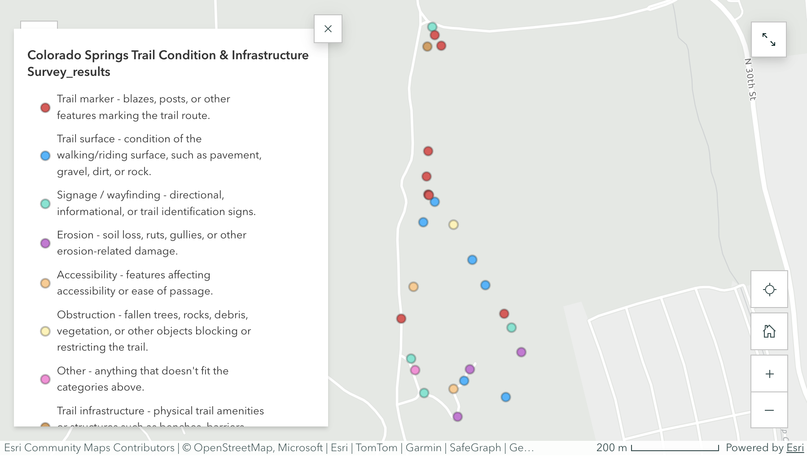

# Trail Condition & Infrastructure Survey

## Overview

A field-based GIS project documenting trail conditions and infrastructure across Colorado Springs, Colorado.

Field observations are collected using **ArcGIS Survey123** and mapped in ArcGIS to document conditions and infrastructure characteristics along local trails.

## Assessment Categories

The survey captures observations related to:

* Trail condition
* Trail surface
* Obstructions
* Signage and wayfinding
* Accessibility
* General infrastructure condition

## Featured Map

The map shows the spatial distribution of field observations collected through the Survey123 field survey.

## Workflow

**Field observation → Survey123 → ArcGIS → spatial visualization → StoryMap**

The project is designed as a repeatable field-data collection workflow for documenting trail conditions and infrastructure.

## StoryMap

[View the interactive Trail Condition & Infrastructure Survey StoryMap](https://storymaps.arcgis.com/stories/9df180420cd346fc9c70df1ae5ab2701)

## Tools

* ArcGIS Survey123
* ArcGIS
* Field data collection
* GIS visualization

## Portfolio

This project demonstrates the use of GIS and mobile field data collection to document and visualize real-world trail and infrastructure conditions.
